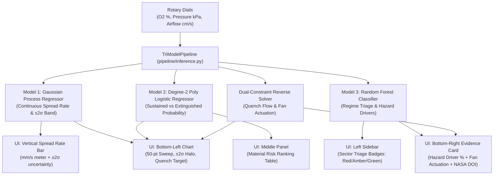

# Backend Handoff Guide: Tri-Model ML Pipeline & Avionics Inference

> **Target Audience:** Backend API / FastAPI Developer  
> **Status:** Production-Ready for Integration  
> **Grounding:** 100% NASA Physical Sciences Informatics (PSI) Microgravity Combustion Telemetry (BASS-I, BASS-II, Saffire-II)  
> **No Synthetic Columns:** No simulated CO, smoke optical density, or synthetic cabin temperature. Strictly empirical physics parameters.

---

## 1. Tri-Model Architecture Overview

The combustion avionics system runs three specialized, NASA-grounded scikit-learn models alongside a dual-constraint reverse solver. All three models evaluate concurrently or in cascade when a flight controller adjusts the three avionics dials: **Oxygen Concentration ($O_2\%$)**, **Cabin Pressure ($P$ in kPa)**, and **Ventilation Airflow Velocity ($v$ in cm/s)**.



### Tri-Model Summary Table

| Model / Subsystem | Machine Learning Architecture | Physical Target / Role | Primary Inputs | Primary Output | Target UI Panel / Widget |
|---|---|---|---|---|---|
| **Model 1** | `GaussianProcessRegressor`<br/>(`ConstantKernel * RBF + WhiteKernel`) | Continuous flame spread rate ($\text{mm/s}$) & epistemic uncertainty ($\pm 2\sigma$) | $O_2\%$, Pressure, Airflow, LOI %, Material | `flame_spread_mm_s`, `uncertainty_2sigma_mm_s`, `spread_lower_mm_s`, `spread_upper_mm_s` | **Vertical Spread Rate Bar** (gauge replacement) and **Bottom-Left Chart** ($\pm 2\sigma$ confidence halo) |
| **Model 2** | `LogisticRegression`<br/>(Degree-2 `PolynomialFeatures`, balanced) | Binary ignition / sustained combustion probability | $O_2\%$, Pressure, Airflow, LOI %, Material | `probability_sustained`, `probability_extinguished`, `risk_status` (`HIGH`, `ELEVATED`, `LOW`) | **Middle Material Risk Ranking Table** (sorted list with probability bars & status pills) |
| **Model 3** | `RandomForestClassifier`<br/>(200 estimators, balanced) | Combustion regime classification & root-cause driver explainability | $O_2\%$, Pressure, Airflow, LOI %, Material, + Model 1 `flame_spread_mm_s` | `hazard_regime` (`NOMINAL`, `ELEVATED`, `CRITICAL`), `badge_color`, `hazard_drivers` (feature %) | **Left Sidebar** (Sector triage badges) and **Bottom-Right Evidence Card** ("Why is this burning?" % drivers) |
| **Reverse Solver** | Dual-Constraint Grid Optimizer | Calculates minimum airflow to safely quench active combustion | Material, $O_2\%$, Pressure, probability cutoff (0.05), spread threshold (0.5 mm/s) | `recommended_flow_velocity_cm_s`, `airflow_delta_cm_s`, fan command, quench status | **Bottom-Left Chart** (target point marker) and **Bottom-Right Evidence Card** (recommended actuation) |

---

## 2. Artifact & Module Directory Structure

All artifacts are persisted under `models/` and are ready to be loaded at FastAPI server startup:

```
uliens-fire-safety-dashboard/
├── data/
│   └── processed/
│       └── clean_combustion_data.csv          # 248 NASA flight records (0 nulls)
├── model1/                                    # Model 1 Package
│   ├── __init__.py
│   ├── train.py                               # Train GP regressor
│   └── inference.py                           # Standalone Model1 class
├── model2/                                    # Model 2 Package
│   ├── __init__.py
│   ├── train.py                               # Train Poly Logistic classifier
│   └── inference.py                           # Standalone Model2 class
├── model3/                                    # Model 3 Package
│   ├── __init__.py
│   ├── train.py                               # Train Random Forest classifier
│   └── inference.py                           # Standalone Model3 class
├── pipeline/                                  # Unified Tri-Model Module
│   ├── __init__.py                            # Exports TriModelPipeline
│   └── inference.py                           # Consolidated avionics evaluation API
└── models/                                    # Pre-trained Artifacts & Metadata
    ├── provenance_metadata.json               # NASA PSI investigation IDs, DOIs, standards
    ├── model1/
    │   ├── model1_gaussian_process.pkl        # Fitted GP pipeline
    │   ├── material_metadata.json             # Per-material training ranges & spread stats
    │   └── metrics.json                       # Validation metrics (R2: 0.978, MAE: 0.052 mm/s)
    ├── model2/
    │   ├── model2_polynomial_logistic.pkl     # Fitted polynomial logistic pipeline
    │   ├── material_metadata.json             # Per-material training ranges & counts
    │   └── metrics.json                       # Validation metrics (Accuracy: 0.80, F1: 0.868)
    └── model3/
        ├── model3_random_forest.pkl           # Fitted Random Forest pipeline
        ├── material_metadata.json             # Per-material regime counts & medians
        ├── feature_importances.json           # Global hazard driver % weights
        ├── regime_derivation.json             # NASA regime labeling specification
        └── metrics.json                       # Validation metrics (Accuracy: 0.90, F1: 0.901)
```

---

## 3. Server Startup & Quickstart Import

You do **not** need to load individual model files manually or write any `scikit-learn` or physics code. Simply instantiate `TriModelPipeline` as a singleton in your FastAPI lifespan or module scope:

```python
# app/core/ml.py or inside your FastAPI lifespan handler:
from pipeline import TriModelPipeline

# Initialize once at server startup (loads all pickles into memory):
ml_pipeline = TriModelPipeline()
```

### Supported Flight Materials (8 NASA PSI Test Benchmarks)

Call `ml_pipeline.materials` to get the complete list of valid materials:
1. `Kapton Hn` (Aromatic polyimide film)
2. `Nomex Ht90-40` (Aramid flame-resistant fabric)
3. `Paraffin Wax` (Phase-change thermal management wax)
4. `Pmma Cast Acrylic` (Transparent acrylic window/structure benchmark)
5. `Ptfe Teflon` (Polytetrafluoroethylene wiring insulation)
6. `Sibal Fabric Blend` (75% cotton / 25% fiberglass standard calibration fabric)
7. `Silicone Rtv-560` (High-temperature spacecraft gap sealant)
8. `Ultem Polyetherimide` (PEI thermoplastic avionics bracket structural resin)

---

## 4. API Function Signatures & Exact Payloads

### 4.1 Master Endpoint: `evaluate_avionics_state()`

> [!TIP]
> **Recommended Single-Call Strategy:** Use this function to power your main state evaluation route (e.g. `POST /api/avionics/evaluate` or a WebSocket event). It runs all three models and the reverse solver in ~5ms and returns a payload that populates the entire dashboard.

#### Signature
```python
ml_pipeline.evaluate_avionics_state(
    material: str,
    oxygen_pct: float,
    pressure_kpa: float,
    flow_velocity_cm_s: float,
    cutoff_probability: float = 0.05,
    spread_threshold_mm_s: float = 0.5,
    sweep_points: int = 50,
) -> dict[str, Any]
```

#### Example Call
```python
result = ml_pipeline.evaluate_avionics_state(
    material="Pmma Cast Acrylic",
    oxygen_pct=21.0,
    pressure_kpa=101.3,
    flow_velocity_cm_s=10.0,
    cutoff_probability=0.05,
    spread_threshold_mm_s=0.5,
)
```

#### Exact Output Payload Schema
```json
{
  "inputs": {
    "material": "Pmma Cast Acrylic",
    "oxygen_pct": 21.0,
    "pressure_kpa": 101.3,
    "flow_velocity_cm_s": 10.0,
    "cutoff_probability": 0.05,
    "spread_threshold_mm_s": 0.5
  },
  "spread_rate_meter": {
    "flame_spread_mm_s": 2.0389,
    "uncertainty_2sigma_mm_s": 0.4502,
    "spread_lower_mm_s": 1.5887,
    "spread_upper_mm_s": 2.4892,
    "out_of_material_training_range": false
  },
  "sector_triage": [
    {
      "material_name": "Silicone Rtv-560",
      "hazard_regime": "CRITICAL",
      "badge_color": "red",
      "probability_sustained": 0.953,
      "flame_spread_mm_s": 1.201,
      "psi_investigation_id": "PSI-99",
      "mission_source": "Saffire-II (Cygnus Flight Burns)",
      "out_of_material_training_range": true
    },
    {
      "material_name": "Pmma Cast Acrylic",
      "hazard_regime": "CRITICAL",
      "badge_color": "red",
      "probability_sustained": 0.7278,
      "flame_spread_mm_s": 2.0389,
      "psi_investigation_id": "PSI-26",
      "mission_source": "BASS-I (ISS Flight Telemetry)",
      "out_of_material_training_range": false
    },
    {
      "material_name": "Paraffin Wax",
      "hazard_regime": "NOMINAL",
      "badge_color": "green",
      "probability_sustained": 0.5367,
      "flame_spread_mm_s": 0.812,
      "psi_investigation_id": "PSI-GEN",
      "mission_source": "BASS-I (ISS Flight Telemetry)",
      "out_of_material_training_range": false
    }
  ],
  "material_risk_ranking": [
    {
      "material_name": "Silicone Rtv-560",
      "probability_sustained": 0.953,
      "probability_extinguished": 0.047,
      "risk_status": "HIGH",
      "predicted_outcome": "SUSTAINED",
      "flame_spread_mm_s": 1.201,
      "uncertainty_2sigma_mm_s": 0.412,
      "spread_lower_mm_s": 0.789,
      "spread_upper_mm_s": 1.613,
      "hazard_regime": "CRITICAL",
      "badge_color": "red",
      "loi_threshold_pct": 29.0,
      "critical_flow_window_cms": [2.0, 12.0],
      "psi_investigation_id": "PSI-99",
      "mission_source": "Saffire-II (Cygnus Flight Burns)",
      "out_of_material_training_range": true
    }
  ],
  "airflow_simulation": {
    "material_name": "Pmma Cast Acrylic",
    "critical_flow_window_cms": [3.0, 15.0],
    "loi_threshold_pct": 21.0,
    "quench_target": {
      "material_name": "Pmma Cast Acrylic",
      "cutoff_probability": 0.05,
      "spread_threshold_mm_s": 0.5,
      "search_range_cm_s": [0.0, 49.0],
      "step_cm_s": 0.5,
      "recommended_flow_velocity_cm_s": null,
      "probability_sustained": null,
      "flame_spread_mm_s": null,
      "uncertainty_2sigma_mm_s": null,
      "satisfies_dual_constraints": false,
      "status": "no_supported_quench_point_found",
      "action_summary": "No airflow setting within tested envelope quenches combustion under current O2/pressure levels. Depressurization or O2 scrubbing required."
    },
    "sweep_points": [
      {
        "flow_velocity_cm_s": 0.0,
        "flame_spread_mm_s": 0.5556,
        "uncertainty_2sigma_mm_s": 0.4594,
        "spread_lower_mm_s": 0.0962,
        "spread_upper_mm_s": 1.015,
        "probability_sustained": 0.7131,
        "out_of_material_training_range": false
      },
      {
        "flow_velocity_cm_s": 1.0,
        "flame_spread_mm_s": 0.6982,
        "uncertainty_2sigma_mm_s": 0.456,
        "spread_lower_mm_s": 0.2422,
        "spread_upper_mm_s": 1.1542,
        "probability_sustained": 0.7082,
        "out_of_material_training_range": false
      }
    ]
  },
  "evidence_and_actuation": {
    "active_regime": "CRITICAL",
    "badge_color": "red",
    "regime_probabilities": {
      "CRITICAL": 0.945,
      "ELEVATED": 0.055,
      "NOMINAL": 0.0
    },
    "hazard_drivers": [
      {
        "feature": "flame_spread_mm_s",
        "label": "Flame Spread Rate",
        "importance_pct": 32.71
      },
      {
        "feature": "material_name",
        "label": "Material Type",
        "importance_pct": 17.03
      },
      {
        "feature": "loi_threshold_pct",
        "label": "LOI Threshold",
        "importance_pct": 15.23
      },
      {
        "feature": "flow_velocity_cm_s",
        "label": "Airflow Velocity",
        "importance_pct": 14.79
      },
      {
        "feature": "oxygen_pct",
        "label": "O2 Concentration",
        "importance_pct": 13.08
      },
      {
        "feature": "pressure_kpa",
        "label": "Cabin Pressure",
        "importance_pct": 7.15
      }
    ],
    "reverse_solver_recommendation": {
      "material_name": "Pmma Cast Acrylic",
      "status": "no_supported_quench_point_found",
      "recommended_flow_velocity_cm_s": null,
      "probability_sustained": null,
      "flame_spread_mm_s": null,
      "uncertainty_2sigma_mm_s": null,
      "satisfies_dual_constraints": false,
      "action_summary": "No airflow setting within tested envelope quenches combustion under current O2/pressure levels. Depressurization or O2 scrubbing required."
    },
    "airflow_delta_cm_s": null,
    "fan_actuation_command": "DEPRESS_OR_SCRUB_REQUIRED",
    "nasa_provenance": {
      "material_name": "Pmma Cast Acrylic",
      "psi_investigation_id": "PSI-26",
      "mission_source": "BASS-I (ISS Flight Telemetry)",
      "standard_ref": "NASA-STD-6001B Test 1",
      "source_doi_url": "https://psi.nasa.gov/physci/repo/data/investigations/PSI-26",
      "loi_threshold_pct": 21.0,
      "critical_flow_window_cms": [3.0, 15.0],
      "historical_finding": "BASS / Saffire-IV: Sustained continuous concurrent flame spread under forced microgravity ventilation; exhibited false-pass behavior relative to 1g tests.",
      "total_nasa_test_records": 172
    }
  }
}
```

---

### 4.2 Individual Component Functions

If you prefer lightweight micro-endpoints instead of the master call, you can call each method individually:

#### A. Model 1 Only — Spread Rate & Uncertainty
```python
spread_data = ml_pipeline.model1.predict_spread(
    material="Pmma Cast Acrylic",
    oxygen_pct=21.0,
    pressure_kpa=101.3,
    flow_velocity_cm_s=10.0,
)
# Returns: {'flame_spread_mm_s': 2.0389, 'uncertainty_2sigma_mm_s': 0.4502, ...}
```

#### B. Model 2 Only — Material Risk Ranking
```python
rankings = ml_pipeline.model2.predict_materials(
    oxygen_pct=21.0,
    pressure_kpa=101.3,
    flow_velocity_cm_s=10.0,
    cutoff=0.05,
)
# Returns list sorted by probability_sustained descending
```

#### C. Model 3 Only — Regime Classification & Drivers
```python
regime_data = ml_pipeline.model3.predict_regime(
    material="Pmma Cast Acrylic",
    oxygen_pct=21.0,
    pressure_kpa=101.3,
    flow_velocity_cm_s=10.0,
    flame_spread_mm_s=2.0389,  # From Model 1
)
# Returns: {'hazard_regime': 'CRITICAL', 'badge_color': 'red', 'hazard_drivers': [...]}
```

#### D. Bottom-Left Simulation Sweep
```python
sim_data = ml_pipeline.airflow_sweep(
    material="Pmma Cast Acrylic",
    oxygen_pct=21.0,
    pressure_kpa=101.3,
    points=50,
)
# Returns: {'sweep_points': [... 50 items ...], 'critical_flow_window_cms': [3.0, 15.0], 'quench_target': {...}}
```

#### E. Upgraded Dual-Constraint Reverse Solver
```python
solver_data = ml_pipeline.reverse_solver(
    material="Nomex Ht90-40",
    oxygen_pct=21.0,
    pressure_kpa=101.3,
    cutoff_probability=0.5,
    spread_threshold_mm_s=1.0,
)
# Returns: {'status': 'dual_constraint_quench_found', 'recommended_flow_velocity_cm_s': 8.0, ...}
```

---

## 5. UI Mapping Cheat Sheet

Here is the exact mapping between frontend dashboard widgets and JSON fields:

```
+---------------------------------------------------------------------------------------------------------------+
| TOP HEADER: NASA Microgravity Fire Safety Avionics                                                            |
+---------------------------------------------------------------------------------------------------------------+
| LEFT SIDEBAR                      | ROTARY GAUGES & SPREAD BAR        | MIDDLE PANEL: MATERIAL RISK RANKING   |
| [Sector Triage Badges]            | [O2 %]  [Pressure]  [Airflow]     | [Sorted by probability_sustained]     |
| • Sector 1 (Acrylic): RED         |                                   | Mat Name | P(Sustained) | Status Pill|
|   `sector_triage[i].badge_color`  | [SPREAD RATE METER]               | PMMA     | 72.8%        | HIGH       |
|   `sector_triage[i].hazard_regime`| `spread_rate_meter.flame_spread`  | Sibal    | 49.0%        | ELEVATED   |
| • PSI ID & Mission Source         | `spread_rate_meter.uncertainty_2σ`| PTFE     | 0.03%        | LOW        |
|                                   | `[spread_lower, spread_upper]`    | `material_risk_ranking[i].risk_status`|
+-----------------------------------+-----------------------------------+---------------------------------------+
| BOTTOM-LEFT: AIRFLOW SIMULATION CHART                                 | BOTTOM-RIGHT: EVIDENCE & ACTUATION    |
| • Solid line: Model 1 `flame_spread_mm_s` vs airflow                   | • "Why is this burning?" Drivers:     |
| • Shaded area: `[spread_lower_mm_s, spread_upper_mm_s]` (±2σ Halo)    |   `evidence_and_actuation.drivers[%]` |
| • Dashed line: Model 2 `probability_sustained`                        | • Reverse-Solver Actuation:           |
| • Vertical brackets: `critical_flow_window_cms`                       |   `fan_actuation_command`             |
| • Quench marker: `quench_target.recommended_flow_velocity_cm_s`      | • Citation: `nasa_provenance.doi_url` |
+---------------------------------------------------------------------------------------------------------------+
```

### Detailed Field Mapping Reference

| UI Panel & Widget | JSON Response Field | Type & Format | Visual / Functional Presentation |
|---|---|---|---|
| **Vertical Spread Rate Bar** | `spread_rate_meter.flame_spread_mm_s` | `float` (0.00 – 7.08 mm/s) | Center needle / bar height value |
| **Vertical Spread Rate Bar** | `spread_rate_meter.uncertainty_2sigma_mm_s` | `float` (e.g. ±0.45 mm/s) | Numeric uncertainty readout next to needle |
| **Vertical Spread Rate Bar** | `spread_rate_meter.spread_lower_mm_s` / `spread_upper_mm_s` | `float` (mm/s) | Upper and lower tick marks flanking the active rate |
| **Left Sidebar (Sector Triage)** | `sector_triage[i].hazard_regime` | `"NOMINAL"` \| `"ELEVATED"` \| `"CRITICAL"` | Text label on compartment sector card |
| **Left Sidebar (Sector Triage)** | `sector_triage[i].badge_color` | `"green"` \| `"amber"` \| `"red"` | Border and fill color of status pill / badge |
| **Left Sidebar (Sector Triage)** | `sector_triage[i].psi_investigation_id` | `"PSI-26"`, `"PSI-98"`, etc. | NASA flight benchmark sub-tag |
| **Middle Risk Table** | `material_risk_ranking[i].probability_sustained` | `float` (0.0 to 1.0) | Displayed as percentage (e.g., `72.8%`) & progress bar width |
| **Middle Risk Table** | `material_risk_ranking[i].risk_status` | `"HIGH"` \| `"ELEVATED"` \| `"LOW"` | Colored pill badge (`HIGH` = red, `ELEVATED` = amber, `LOW` = cyan/neutral) |
| **Bottom-Left Chart** | `airflow_simulation.sweep_points` | `list[dict]` (50 items) | X-axis: `flow_velocity_cm_s`; Left Y-axis: `flame_spread_mm_s`; Right Y-axis: `probability_sustained` |
| **Bottom-Left Chart (Halo)** | `sweep_points[i].spread_lower_mm_s` / `spread_upper_mm_s` | `float` | Area chart fill (semi-transparent shaded halo around spread line) |
| **Bottom-Left Chart (Window)** | `airflow_simulation.critical_flow_window_cms` | `[min, max]` (e.g. `[3.0, 15.0]`) | Vertical shaded band or bracket indicators highlighting microgravity airflow danger zone |
| **Bottom-Left Chart (Quench)** | `airflow_simulation.quench_target` | `dict` | Star / target point marker at `recommended_flow_velocity_cm_s` |
| **Bottom-Right Card (Drivers)** | `evidence_and_actuation.hazard_drivers` | `list[{feature, label, importance_pct}]` | Horizontal progress bars displaying driver impact (e.g., "Flame Spread Rate: 32.7%", "Airflow Velocity: 14.8%") |
| **Bottom-Right Card (Actuation)**| `evidence_and_actuation.fan_actuation_command` | `string` | Emergency actuation pill (`THROTTLE_DOWN (-X.X cm/s)`, `NOMINAL_HOLD`, or `DEPRESS_OR_SCRUB_REQUIRED`) |
| **Bottom-Right Card (Citation)** | `evidence_and_actuation.nasa_provenance` | `dict` | Clickable hyperlink to NASA PSI repository, standard reference (`NASA-STD-6001B`), and mission notes |

---

## 6. Edge Cases & Validation Rules

> [!WARNING]
> **Out-of-Range Handling:**  
> The NASA test matrix tested airflows from 0.0 to 49.0 cm/s, $O_2$ from 13.6% to 34.0%, and pressure from 70.3 to 102.2 kPa. If the user scrolls dials beyond a specific material's observed envelope:
> - `out_of_material_training_range` returns `true`.
> - The UI should display a subtle amber advisory: *"Extrapolated condition: exceeds empirical NASA test boundary for this material"*.
> - The models will still return mathematical estimates, but with appropriately expanded $\pm 2\sigma$ uncertainty bands.

> [!NOTE]
> **Reverse Solver Quench Feasibility:**  
> If an active material is highly combustible (such as PMMA at nominal 21% $O_2$), reducing airflow alone will **not** bring sustained probability below 5% because microgravity boundary layers sustain smoldering even at near-zero forced flow. In such cases:
> - `quench_target.status` returns `"no_supported_quench_point_found"`.
> - `quench_target.recommended_flow_velocity_cm_s` is `null`.
> - `fan_actuation_command` will read `"DEPRESS_OR_SCRUB_REQUIRED"`.
> Ensure your frontend handles `recommended_flow_velocity_cm_s: null` gracefully (by hiding the quench star marker or displaying a caution indicator).

---

## 7. Verification Test Suite

You can verify the entire pipeline on your machine anytime by running:

```powershell
python -c "from pipeline.inference import TriModelPipeline; pipe = TriModelPipeline(); print('Loaded materials:', pipe.materials); assert len(pipe.materials) == 8; res = pipe.evaluate_avionics_state('Pmma Cast Acrylic', 21.0, 101.3, 10.0); print('Pipeline status: OK! Payload keys:', list(res.keys()))"
```

If you need any adjustments to payload shapes or additional derived statistics, all logic is isolated inside `pipeline/inference.py`.
